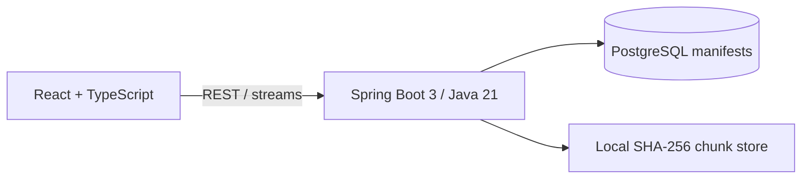

# ChunkVault

ChunkVault is a single-node, content-addressable deduplicating file storage engine. It streams uploads into chunks, addresses those chunks by SHA-256, stores unique bytes once, records ordered manifests in PostgreSQL, and reconstructs downloads without loading whole files into heap.

It is intentionally a storage-systems project—not a Drive/Dropbox clone, distributed filesystem, or microservice demo.

## Five-minute review

Requirements: Docker with Compose.

```bash
cp .env.example .env
docker compose up --build
```

Open `http://localhost:3000`, upload a file, then upload the same file again. Logical storage and chunk references increase; physical storage does not. Open either manifest to inspect shared chunks and download the reconstructed bytes.

CLI proof:

```bash
curl -F file=@sample.bin -F strategy=FIXED_SIZE http://localhost:3000/api/files
curl -F file=@sample.bin -F strategy=FIXED_SIZE http://localhost:3000/api/files
curl http://localhost:3000/api/storage/stats
curl -X POST -H 'Content-Type: application/json' -d '{"scope":"ALL_CHUNKS"}' http://localhost:3000/api/storage/verify
```

## Architecture



The database owns identity, ordering, and references. The filesystem owns immutable bytes. `UNIQUE(chunks.hash)` plus `INSERT ... ON CONFLICT DO NOTHING` resolves concurrent hash insertion; deterministic non-replacing publication resolves the matching filesystem race.

## Core behavior

- Fixed-size 4 MiB chunking is the default.
- Optional Gear-style content-defined chunking uses 1/4/8 MiB min/target/max boundaries.
- SHA-256 paths use two-level fan-out: `ab/cd/abcdef...`.
- Upload and download I/O use bounded buffers.
- `file_chunks` is reference truth; no drift-prone counter is stored.
- Delete removes logical manifests only. GC separately rechecks zero-reference chunks.
- Chunk verification and complete-file verification detect missing or changed bytes.
- File versions reuse any unchanged chunk content.

## API

| Method | Endpoint | Purpose |
| --- | --- | --- |
| `POST` | `/api/files` | Stream a new logical file (`file`, `strategy`) |
| `GET` | `/api/files?page=0&size=20` | Paginated file list |
| `GET` | `/api/files/{id}` | Versions and selected manifest |
| `GET` | `/api/files/{id}/download` | Stream latest reconstruction |
| `DELETE` | `/api/files/{id}` | Remove logical file and manifest references |
| `POST` | `/api/files/{id}/versions` | Stream a new version |
| `GET` | `/api/files/{id}/versions` | Version history |
| `GET` | `/api/files/{id}/versions/compare?from=1&to=2` | Chunk reuse comparison |
| `GET` | `/api/storage/stats` | Logical/physical accounting |
| `POST` | `/api/storage/verify` | Chunk or file integrity scan |
| `POST` | `/api/storage/gc` | Reference-safe reclamation |
| `GET` | `/api/storage/gc/status` | Candidates and latest GC result |

## Local development

Backend requires Java 21, Maven, and PostgreSQL:

```bash
cd backend
DB_URL=jdbc:postgresql://localhost:5432/chunkvault mvn spring-boot:run
```

Frontend requires Node 22+:

```bash
cd frontend
npm install
npm run dev
```

The Vite server proxies `/api` to port 8080. Run `mvn verify` for unit and Testcontainers PostgreSQL integration tests. Integration tests automatically skip when Docker is unavailable.

## Benchmark

```bash
./scripts/run-benchmark.sh
```

The deterministic harness measures chunk hashing, local CAS publication, manifest reconstruction, and checksum validation. It deliberately excludes HTTP and PostgreSQL; see [docs/BENCHMARK_RESULTS.md](docs/BENCHMARK_RESULTS.md) for the exact scope and recorded run.

## Design documents

- [Project plan](docs/PROJECT_PLAN.md)
- [Architecture and failure windows](docs/ARCHITECTURE.md)
- [Relational model](docs/ER_DIAGRAM.md)
- [Interview guide](docs/INTERVIEW_GUIDE.md)
- [Resume bullets](docs/RESUME_BULLETS.md)
- [SDE-1 audit](SDE1_AUDIT.md)

## Limits

ChunkVault supports one backend process and one local storage filesystem. It does not provide authentication, sharing, encryption, compression, replication, multi-node coordination, or distributed GC. See the architecture document before changing filesystem/transaction ordering.
