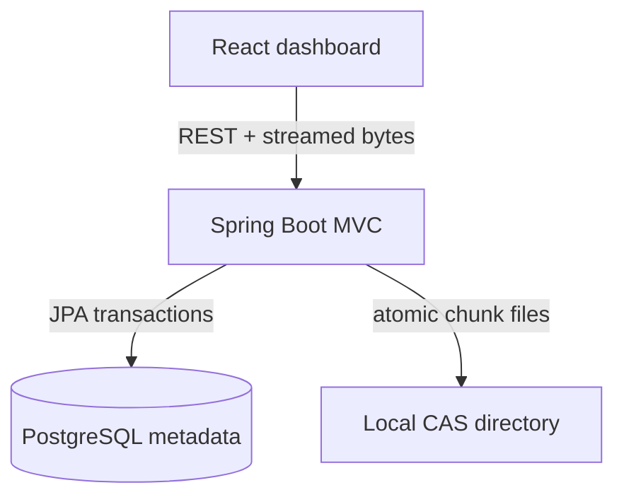
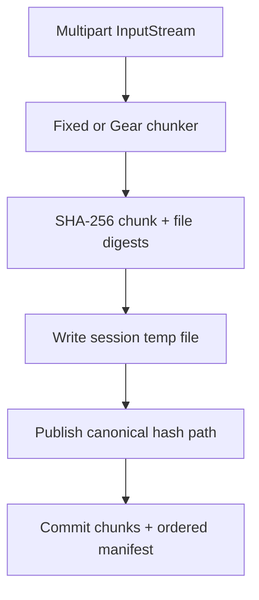

# ChunkVault architecture

## System boundary

There is one backend, one PostgreSQL database, and one chunk-storage filesystem. The database records meaning and ordering; the filesystem holds immutable bytes.

## Upload path

Only one bounded chunk buffer is resident. The default fixed chunk is 4 MiB. CDC uses a 1 MiB minimum, 4 MiB target, and 8 MiB maximum. The manifest contains small descriptors, not file bytes.

Each staged file is closed and forced before publication. Publication first attempts a same-filesystem hard link (which is atomic and non-replacing), then a non-replacing move fallback. If a target already exists, its size and SHA-256 are verified before reuse. This design assumes one local filesystem; network filesystem semantics may differ.

Metadata is committed after chunk files are durable. Chunk rows use `INSERT ... ON CONFLICT DO NOTHING` and are then selected and validated. Therefore concurrent identical uploads converge on one row and one path without relying on check-then-insert.

## Download path

The backend reads `FileChunk` rows ordered by `chunkIndex`, opens each canonical chunk, and copies it to the HTTP response through a fixed-size transfer buffer. It never assembles the file in heap or in a temporary reconstruction file. A complete-file verifier performs the same ordered traversal into a SHA-256 digest sink.

## Consistency model and failure windows

PostgreSQL transactions cannot atomically commit a normal filesystem operation. ChunkVault chooses an ordering that protects referenced data:

| Failure | Result | Recovery |
| --- | --- | --- |
| Temporary chunk write fails | No manifest is committed | Session temp directory is removed in `finally` |
| Filesystem publication succeeds, DB transaction fails | Unreferenced canonical bytes may remain | Later upload reuses them; orphan sweep can delete old untracked paths |
| DB manifest commits | Every referenced canonical file was published first | Normal success path |
| DB GC delete commits, filesystem delete fails | Untracked orphan bytes remain, not data loss | GC records failure; later orphan sweep retries |
| Process stops during temp write | `.tmp/<session>` remains | Startup/GC removes stale temp directories after a grace period |

The reverse ordering—committing metadata before publishing bytes—could expose a downloadable manifest that points to missing content, so it is not used.

## Concurrency strategy

PostgreSQL is the cross-request authority for chunk uniqueness. A fair JVM `ReentrantReadWriteLock` adds an understandable single-node lifecycle boundary: upload/version commits take the read lock; GC takes the write lock. Deletion only removes manifests and does not delete chunk bytes.

GC locks each candidate row, checks in-process download pins, repeats `COUNT(file_chunks)` in a new transaction, deletes zero-reference metadata, commits, and then attempts physical deletion. The grace period avoids racing with canonical files written by an upload whose metadata has not committed. Download descriptors pin their chunk hashes until streaming finishes, protecting a stream if its logical file is deleted concurrently. This is intentionally not safe for several backend replicas; a database advisory lock or lease would be required before scaling out.

## Reference management

`file_chunks` is the source of truth. The application derives a chunk's reference count with SQL. This avoids counter drift after rollbacks or unusual delete paths. It costs aggregate queries, which is acceptable at portfolio scale. A production system might maintain a counter with triggers plus periodic reconciliation.

## Hash collision policy

SHA-256 collisions are assumed computationally infeasible for this non-adversarial single-node project, but equality is not accepted blindly. A matching hash with a different length is an integrity anomaly. Existing canonical bytes are re-hashed during publication; a mismatch aborts the upload. The project does not implement a secondary address namespace for a genuine SHA-256 collision.

## Content-defined chunking

The optional `CONTENT_DEFINED` strategy uses a compact Gear-style rolling fingerprint. After the minimum size, a boundary occurs when the low bits match a mask chosen for the target average size, or unconditionally at the maximum size. The implementation is intentionally small, readable, and tuned for this project. Fixed chunking remains the default.

## Security and operational limits

- Filenames are metadata only and are sanitized for `Content-Disposition`; they never determine storage paths.
- Chunk paths are generated only from validated lowercase 64-character SHA-256 strings.
- Maximum multipart request size is configurable and defaults to 2 GiB.
- Verification is read-only. Deliberate corruption exists only in integration tests.
- CORS defaults to the local frontend origin.
- No antivirus/content-type enforcement is included.
