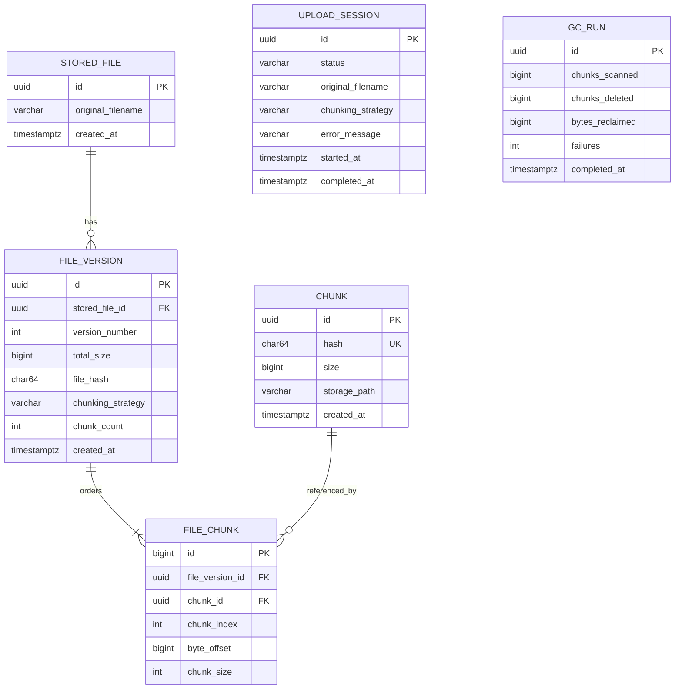

# Metadata model

Important database constraints:

- `chunks(hash)` is unique: the database, not a pre-insert lookup, resolves upload races.
- `file_versions(stored_file_id, version_number)` is unique.
- `file_chunks(file_version_id, chunk_index)` is unique and the download query explicitly orders by `chunk_index`.
- `file_chunks` foreign keys prevent metadata from referencing nonexistent chunks.
- Cascade deletion stops at the manifest: deleting a file cascades through its versions and `file_chunks`, but never through to `chunks`.

`referenceCount` is intentionally absent from `chunks`. Actual references are derived with `COUNT(file_chunks.id)`, preventing counter drift.
